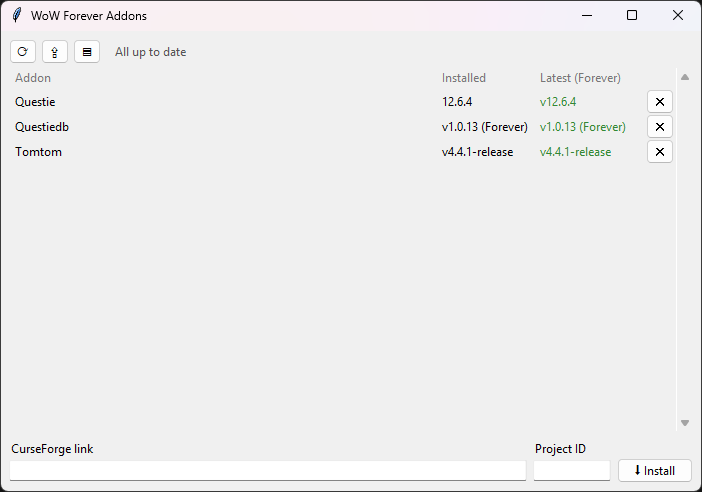
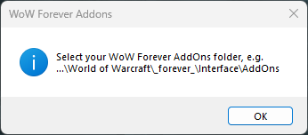
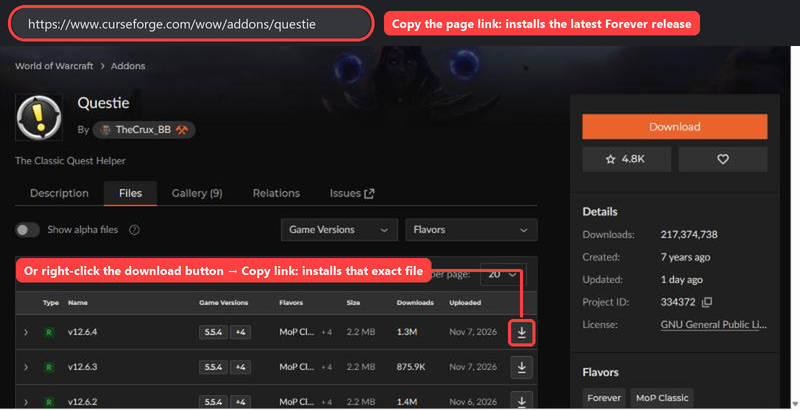
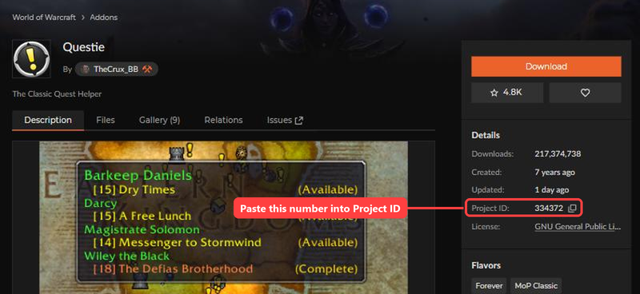
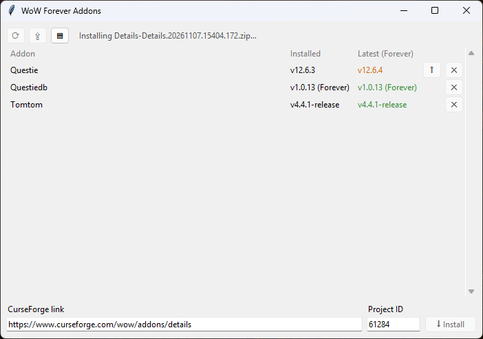
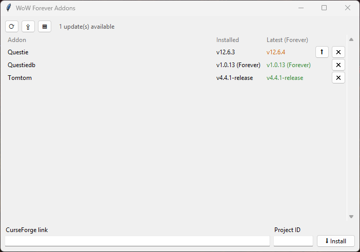
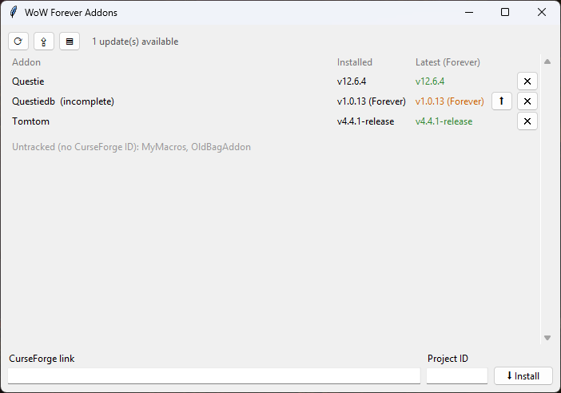

# WoW Forever Addon Manager

A tiny, single-file addon manager for **World of Warcraft: Forever** on Windows. It installs and updates addons from CurseForge.



- **One Python file, no dependencies:** it uses only the standard library (tkinter, urllib, zipfile).
- **Nothing left running:** there's no server or background service and no listening sockets. Closing the window ends the process.
- **Outbound HTTPS to CurseForge only:** connections are allowed only to `www.curseforge.com`, `edge.forgecdn.net` and `mediafilez.forgecdn.net`. Every redirect is checked against that list.
- **Very light:** about 45 MB of RAM, and near-zero CPU when idle.

## Features
- **Install from a link:** paste a CurseForge link plus the addon's Project ID, then click **⬇ Install**. The zip is downloaded, verified and unpacked into your AddOns folder, and Explorer opens with the new folder selected.
- **Update checks** run on launch, or when you press **⟳**. An **⬆** button appears next to any addon with an update, and **⇪** updates them all.
- **Forever builds only:** it offers only stable releases tagged for your Forever client version, which it reads from the game's `.build.info`.
- **Register:** `addons.json` records each addon's project, installed file and the folders it owns. It stays in sync on every launch:
  - Addons you delete by hand are dropped from it.
  - Partly deleted addons are flagged for reinstall.
  - Addons that carry `## X-Curse-Project-ID` in their `.toc` are adopted automatically.
- **Clean updates:** an addon's old folders are removed before the new version is unpacked, so no stale files linger. Multi-folder addons such as DBM are handled.
- **Uninstall** with **✕**, after a confirmation.
- **Safe extraction:** zips with absolute or `..` paths are rejected, and the download size and zip integrity are checked.

## Requirements
- Windows
- Python 3.8 or newer from [python.org](https://www.python.org/downloads/), which includes tkinter

## Run
```bash
pythonw addon_manager.pyw
```
On first run it looks for `_forever_\Interface\AddOns` in common install locations. If it doesn't find it, it asks you to pick the folder and remembers your choice in `addons.json`.



To get a double-click launcher:
1. Create a Windows shortcut with target `pythonw.exe "C:\path\to\addon_manager.pyw"`.
2. Optionally, give it `Wow.exe` as its icon.

## Usage

### 1. Copy a link from CurseForge
Copy the addon page link to install the newest Forever release. To install one exact file, right-click its download button on the **Files** tab and copy that link instead.



### 2. Find the Project ID
The **Project ID** is in the **Details** box on every addon page (Questie's is `334372`). You only enter it once per addon; updates are automatic after that.



**Why it's needed:** CurseForge's addon pages sit behind bot protection, so a script can't look up an addon's numeric ID from its name, and this tool doesn't try to get around that.

### 3. Install
Paste both values and click **⬇ Install**. When the install finishes, Explorer opens with the new addon folder selected.



### Updates
Updates are checked on every launch, or when you press **⟳**. Any addon with an update shows its new version in orange with an **⬆** button next to it; **⇪** updates them all.



### Staying in sync with the folder
- **Deleted by hand:** dropped from the register on the next launch.
- **Partly deleted:** marked *(incomplete)*, with **⬆** to reinstall it.
- **Folders without a CurseForge ID:** listed as untracked, and otherwise left alone.



## Tests
```bash
python -m unittest discover tests
```
The online tests download real addons into a throwaway temp folder. Set `WOWAM_OFFLINE=1` to run only the offline tests.

## Notes and limits
- **Undocumented API:** the tool uses the public JSON endpoints behind curseforge.com, not CurseForge's official keyed API, so site changes could break it.
- **No dependency resolution:** required libraries aren't installed automatically, though most addons bundle theirs.
- **Your settings are safe:** addon settings (SavedVariables) live in `WTF\`, which this tool never touches.
- **Reload the game:** use `/reload` or restart after installing or updating while the game is running.

## License
MIT. Not affiliated with Blizzard Entertainment or CurseForge/Overwolf.
